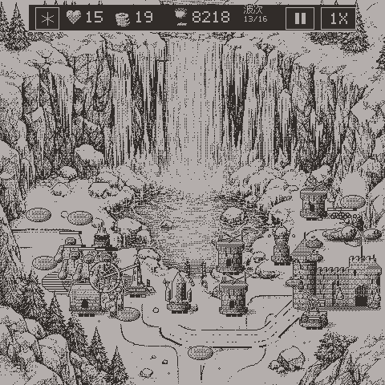
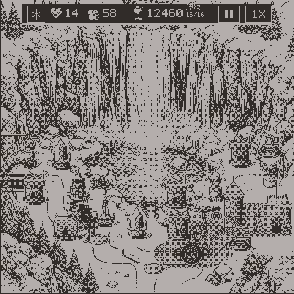
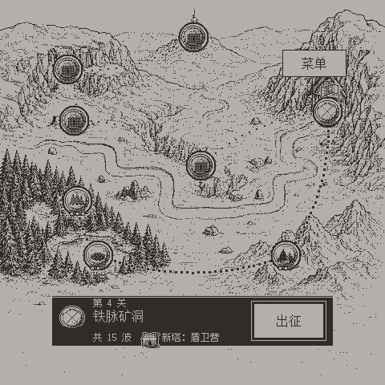

<p align="center">
  
</p>

<h1 align="center">霜线要塞 · Frostline Hold</h1>

<p align="center">
  一款为 ESP-Mosaico 掌机打造的凛冬塔防游戏<br>
  A winter tower defense for the ESP-Mosaico handheld
</p>

<p align="center"><a href="#中文">中文</a> · <a href="#english">English</a></p>

| 战斗 · Battle | 首领 · Boss | 战役 · Campaign |
| :---: | :---: | :---: |
|  |  |  |

---

## 中文

用双色版画风格守住冰原上的要塞：建塔、升级、召唤英雄，挡住一波又一波的怪物。

- **22 个关卡**：8 个章节从霜线山口一路打到冰封要塞，章节之间各有 2 个过程关；战役长卷可以左右拖动，每张地图都有自己的场景动画。
- **精英小首领**：没有大首领的章节关，最后一波会出现一只血厚甲硬、不受控制的精英。
- **7 种防御塔**：箭塔、冰霜塔、投石塔、雷暴塔、符文塔、盾卫营、余烬塔，随关卡逐步解锁，每种都有两条升级路线。
- **15 种敌人**：包括两个首领，矿洞巨蠕和冰封之王。
- **英雄霜卫**：可以召唤上场，并释放冰霜新星。
- **完整体验**：动态标题页、设置页、结局动画、独立的标题和首领配乐、触感震动，中英双语，默认中文。

### 运行

需要 [ESP-Mosaic](https://github.com/esp-mosaico/esp-mosaico-vibe) 工作区，把本项目放在 `projects/frostline_hold`，然后在工作区根目录运行：

```sh
python mosaico.py game sim --project projects/frostline_hold            # 浏览器模拟器
python mosaico.py iris system-update --project projects/frostline_hold  # 编译并安装到设备
```

开发说明见 [docs/DEVELOPMENT.md](docs/DEVELOPMENT.md)。

---

## English

Hold a frozen fortress in a two-tone engraving style: build towers, upgrade them, call in a hero, and stop wave after wave.

- **22 levels**: 8 chapters from Frostline Pass to the Rime Citadel, with 2 interludes after each; the campaign map is a long scroll you drag, and every map has its own living scenery.
- **Champions**: a chapter without a boss ends on a champion, tough, armoured and immune to crowd control.
- **7 towers**: Guard, Frost, Siege, Storm, Rune, Barracks and Ember. They unlock as you advance, each with two upgrade paths.
- **15 enemies**: including two bosses, the Mine Wyrm and the Frost King.
- **The Warden**: a hero you can summon, with a frost nova.
- **The full package**: animated title screen, settings, an ending, separate title and boss themes, haptics, Chinese and English (Chinese by default).

### Run

Needs an [ESP-Mosaic](https://github.com/esp-mosaico/esp-mosaico-vibe) workspace with this project at `projects/frostline_hold`. From the workspace root:

```sh
python mosaico.py game sim --project projects/frostline_hold            # browser simulator
python mosaico.py iris system-update --project projects/frostline_hold  # build and install
```

Developer notes: [docs/DEVELOPMENT.md](docs/DEVELOPMENT.md).

---

Proprietary. © 2026 hkgood. All rights reserved. See [LICENSE](LICENSE).
